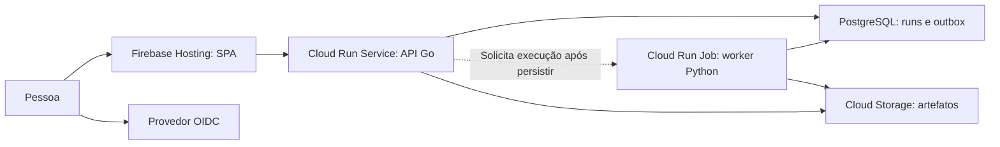

# Comparativo de deploy e custos do LabIA no Google Cloud

Data: **11/10/2026**. Estado: **comparação concluída; Cloud Run escolhido para a primeira demo**.

Este documento explica as alternativas e apresenta estimativas de planejamento. A escolha da opção 1 foi formalizada no [ADR 0001 — Cloud Run para a demo sob demanda](../adr/0001-cloud-run-para-demo-sob-demanda.md). O comparativo permanece como apoio à decisão; implementação e deploy continuam pendentes.

O LabIA continua sendo um esqueleto: nenhuma aplicação, infraestrutura, benchmark ou demo foi implementada ou executada nesta análise. Referências: [projeto](../../README.md), [arquitetura](README.md) e [evidência desta revisão](../evidence/2026-10-11-comparativo-deploy-gcp.md).

## O que estamos tentando hospedar

| Parte | Responsabilidade | Necessidade de hospedagem |
|---|---|---|
| Console React/TypeScript/Vite | Interface, criação e consulta de runs, resultados e operação. | Arquivos estáticos, se mantivermos uma SPA sem renderização no servidor. |
| API Go modular | HTTP, autorização por tenant e objeto, catálogo e persistência de runs. | Processo que responde a requisições; estado durável fora da instância. |
| Workers Python | Dados, inferência e avaliação CPU. | Tarefas finitas; algumas integrações futuras podem precisar de consumidores contínuos. |
| PostgreSQL | Runs, outbox, resultados e, quando necessário, pgvector. | Banco com persistência, conexões limitadas, backups e restauração. |
| Artefatos | Relatórios, datasets autorizados e modelos fora do Git. | Armazenamento de objetos com acesso controlado e política de retenção. |
| Treinamento | Experimentos separados da inferência. | Jobs com recursos e duração próprios; GPU exige orçamento separado. |

O usuário informou aproximadamente **R$100/mês** de gasto atual no Google Cloud, dois Cloud Run, uma VM e Firebase, e prefere **ativar o LabIA sob demanda**. Esse gasto foi informado, não conciliado com uma fatura nesta revisão. Os R$100 não representam autorização para aumentar a despesa.

## Diferença entre os modelos

- **IaaS, como Compute Engine:** alugamos uma máquina e administramos o sistema e a aplicação.
- **Plataforma gerenciada, como App Engine:** entregamos código ou uma aplicação ao ambiente definido pelo provedor.
- **Containers gerenciados, como Cloud Run:** entregamos uma imagem; o provedor inicia instâncias e gerencia a infraestrutura de execução.
- **Kubernetes gerenciado, como GKE:** o provedor gerencia parte do cluster; nós definimos como workloads são distribuídos e operados.
- **Funções, como Cloud Run functions:** entregamos um handler acionado por HTTP ou evento.
- **Hospedagem estática, como Firebase Hosting:** publicamos arquivos que o navegador executa, sem um servidor da aplicação para gerar cada página.

"Serverless" não significa ausência de servidores nem gratuidade. Significa que administramos menos da infraestrutura subjacente. Banco, rede, armazenamento, imagens, builds e serviços externos têm cobranças próprias.

## Compute Engine: uma máquina sob nosso controle

O Compute Engine fornece VMs com sistema operacional, CPU, RAM e discos. Podemos instalar Docker, executar API, worker e PostgreSQL e organizar os processos com Compose. A infraestrutura física é do Google; o gerenciamento do sistema e das aplicações fica conosco. [Visão geral oficial](https://docs.cloud.google.com/compute/docs/overview).

**Por que usar:** controle sobre processos contínuos, bibliotecas nativas, portas e configuração; boa continuidade com o ambiente local; possibilidade de aproveitar capacidade já contratada. Uma VM também serve a experimentos que não cabem nas restrições de uma plataforma serverless.

**Por que evitar como primeira demo pública:** precisamos cuidar de atualizações, TLS, firewall, deploy, supervisão dos processos, backup e recuperação. Em uma VM única, um problema do host pode afetar todos os componentes. Uma máquina ligada custa durante a janela inteira, mesmo ociosa. Discos e IPs podem continuar cobrando quando ela está parada.

**Aplicação ao LabIA:** opção válida para uma demo pequena em uma VM exclusiva, ligada somente durante apresentações. Na VM atual, a convivência com aplicações existentes precisa de análise de capacidade e isolamento; não basta instalar mais containers.

### A VM atual e o possível upgrade

Os dados fornecidos e a consulta de inventário confirmaram **e2-small, 2 GiB, em `us-west1-a`, Debian 12 e disco balanced de 16 GiB**. O print local apresentou CPU de 0,5%, memória de 90,6% (1,9 de 2,1 GB) e disco de 74,4% (11,0 de 14,8 GB). É uma fotografia pontual, não uma série de capacidade.

Esse painel não discrimina memória das aplicações, cache recuperável, swap ou limites dos containers. Conferir `MemAvailable`, consumo por processo/container, OOM, swap e histórico antes de concluir que falta RAM. A definição de `MemAvailable` está na [documentação do kernel Linux](https://www.kernel.org/doc/html/latest/filesystems/proc.html).

**Avaliação:** e2-medium, com 4 GiB, é um próximo tamanho razoável se houver pressão real de memória nos serviços atuais. Não ampliar a VM apenas para acrescentar o LabIA sob demanda. CPU baixa não comprova memória disponível; RAM adicional não aumenta o disco. Um upgrade dentro dessa série requer parada e retomada da VM, com indisponibilidade planejada. [Alteração do tipo de máquina](https://docs.cloud.google.com/compute/docs/instances/changing-machine-type-of-stopped-instance).

## App Engine: hospedar aplicações em um ambiente gerenciado

App Engine organiza aplicações em serviços, versões e instâncias, com infraestrutura e escalabilidade gerenciadas. Existem dois ambientes com diferenças importantes:

| Ambiente | Como funciona | Implicação para o LabIA |
|---|---|---|
| Standard | Runtimes suportados, sandbox e possibilidade de chegar a zero instâncias. | Serve a aplicações web compatíveis; dependências e processamento de fundo precisam respeitar suas restrições. |
| Flexible | Containers executados em VMs, incluindo runtimes customizados. | Mais liberdade, mas pelo menos uma instância permanece ativa por versão em execução; não escala a zero. |

**Por que usar:** aplicações já desenvolvidas para App Engine, equipe familiarizada com seus runtimes e operação por versões. Standard pode ser econômico com tráfego pequeno e configuração adequada.

**Por que evitar aqui:** começamos um projeto novo, com Go e Python empacotados em containers e execução de jobs. Flexible adiciona capacidade permanente ao perfil sob demanda. Standard não resolve sozinho a hospedagem do PostgreSQL nem todos os workers. A própria documentação recomenda avaliar Cloud Run para projetos novos. [Comparação dos ambientes](https://docs.cloud.google.com/appengine/docs/the-appengine-environments).

**Custo:** Standard depende de classe, horas faturáveis e franquia; Flexible inclui recursos ativos mesmo sem visitas. Não estimar "App Engine completo" contando somente o handler HTTP e omitindo banco e workers. [Preços oficiais](https://cloud.google.com/appengine/pricing).

## Cloud Run: containers sem administrar o cluster

Cloud Run executa containers em infraestrutura gerenciada. Podemos preservar a API Go modular e uma imagem Python compartilhada, sem criar um serviço por laboratório. Há modelos de execução diferentes: [visão geral](https://docs.cloud.google.com/run/docs/overview/what-is-cloud-run).

| Modelo | O que faz | Uso no LabIA |
|---|---|---|
| Service | Responde a HTTP; pode iniciar instâncias conforme as requisições e chegar a zero com configuração adequada. | API Go; eventualmente inferência curta via HTTP. |
| Job | Executa uma ou mais tarefas e termina. | Worker CPU em lote, avaliação, migração e tarefas operacionais. |
| Worker pool | Mantém consumidores de fundo sem depender de HTTP. | Consumidor contínuo de Kafka ou Pub/Sub pull, somente se essa necessidade aparecer. |

**Por que usar:** menos trabalho com servidores, imagens Go/Python reaproveitáveis, revisões para deploy e escala adequada a tráfego esporádico. Services com mínimo de instâncias zero e jobs finitos combinam com demos.

**Por que evitar ou reavaliar:** cold starts podem afetar a primeira interação; a instância pode terminar; arquivos locais não são persistência durável. Serviços HTTP têm limites de tempo. Um loop Python contínuo exige um modelo e faturamento apropriados; worker pools não têm a mesma escala automática por requisições e precisam de instâncias ativas para trabalhar.

Services têm timeout HTTP configurável até 60 minutos. Tasks CPU de jobs podem ter timeout até sete dias; tasks com GPU têm limite de uma hora na documentação consultada. São máximos da plataforma, não metas de duração para nossas demos. [Timeout HTTP](https://docs.cloud.google.com/run/docs/configuring/request-timeout), [timeout de jobs](https://docs.cloud.google.com/run/docs/configuring/task-timeout).

Um service com cobrança por requisição não deve iniciar trabalho durável e depender de uma thread continuar depois da resposta. Persistir primeiro, executar em um job e guardar o resultado fora da instância. [Contrato de execução](https://docs.cloud.google.com/run/docs/container-contract).

**Custo:** services cobram recursos conforme o modo de faturamento; jobs cobram a execução das instâncias; manter capacidade aquecida ou consumidores ativos muda a economia. O banco não escala a zero junto com a API. Builds e Artifact Registry também têm preços próprios. [Preços oficiais](https://cloud.google.com/run/pricing).

## Google Kubernetes Engine: operar workloads com Kubernetes

GKE é Kubernetes gerenciado. Trabalhamos com Pods, Deployments, Jobs, Services e políticas de operação. O Google gerencia o control plane; a divisão do trabalho com nós varia: [arquitetura do cluster](https://docs.cloud.google.com/kubernetes-engine/docs/concepts/cluster-architecture).

- **Autopilot:** automatiza mais a infraestrutura e aplica restrições e configurações próprias.
- **Standard:** permite mais controle sobre nós e configuração, com maior responsabilidade operacional.

**Por que usar:** quando precisamos estudar ou operar agendamento, políticas, isolamento, consumidores contínuos e componentes Kubernetes; quando uma limitação concreta de outra plataforma exige essa flexibilidade. [Modos de operação](https://docs.cloud.google.com/kubernetes-engine/docs/concepts/choose-cluster-mode).

**Por que evitar agora:** o produto ainda não executa localmente e não demonstrou necessidade de um cluster. É necessário operar workloads, rede, recursos solicitados, rollouts e observabilidade mesmo em Autopilot. Containers, crescimento futuro ou presença de IA, isoladamente, não justificam Kubernetes.

**Custo:** a tarifa de gerenciamento é US$0,10 por hora de cluster, com crédito mensal elegível para Autopilot e Standard zonal. Esse crédito não paga nós, Pods, discos ou rede. Sem crédito, 730 horas representam US$73 somente de gerenciamento. Um cluster regional Standard não recebe esse crédito. [Preços oficiais](https://cloud.google.com/kubernetes-engine/pricing).

**Aplicação ao LabIA:** experimento temporário de `reliability-platform`, quando houver um sistema executável para comparar. Desligar Pods não equivale a remover todos os recursos faturáveis do cluster. A comparação deve prever criação, janela de uso e encerramento.

## Cloud Functions / Cloud Run functions: executar handlers por eventos

A antiga Cloud Functions de segunda geração aparece hoje como **Cloud Run functions**: código de função é transformado em container e publicado como um service. A primeira geração tem diferenças de limites e configuração. [Comparação das versões](https://docs.cloud.google.com/run/docs/functions/comparison).

**O que faz:** executa uma função em resposta a HTTP ou a eventos, como upload de um objeto ou mensagem. O Functions Framework define o handler; serviços como Eventarc e Pub/Sub participam da entrega dos eventos. [Visão geral](https://docs.cloud.google.com/run/docs/functions/overview), [triggers](https://docs.cloud.google.com/run/docs/function-triggers).

**Por que usar:** webhook, validação de um upload, transformação pequena ou automação isolada. Pode ser uma adaptação fina entre um evento cloud e um módulo compartilhado.

**Por que evitar como arquitetura inteira:** espalhar catálogo, autorização, persistência e execução em funções cria mais fronteiras para operar e testar sem necessidade atual. Funções também precisam de banco, controle de concorrência e idempotência. Não substituem jobs de treinamento ou um PostgreSQL.

**Custo:** funções atuais seguem a infraestrutura e o faturamento de Cloud Run; incluir build, registry e entrega de eventos. Não comparar uma função curta sem persistência com o custo do sistema completo.

## Frontend: Firebase Hosting e outras alternativas

**Frontend escolhido:** usar **Firebase Hosting** para o console React + Vite, avaliando reaproveitar o projeto Firebase existente. Hospedagem não obriga a adotar Firestore, Firebase Authentication ou Firebase SDK na aplicação.

O build de uma SPA produz HTML, CSS, JavaScript e assets estáticos; o React executa no navegador. Não precisamos manter Node ou Vite dev server em produção para servir esses arquivos. [Deploy estático do Vite](https://vite.dev/guide/static-deploy).

| Opção | Por que usar | Por que evitar ou adiar |
|---|---|---|
| Firebase Hosting | CDN, HTTPS, domínio e publicação de arquivos estáticos; adequado à SPA e disponível no contexto atual. | Tráfego e versões armazenadas têm franquias e limites; hospedagem não fornece autorização da API. |
| Container estático em Cloud Run | Mesmo mecanismo de deploy da API; útil quando precisamos de um servidor de frontend. | Iniciar compute para entregar arquivos adiciona cold start e operação; uma SPA pode usar hospedagem estática. |
| Firebase App Hosting | Plataforma para aplicações web dinâmicas, integração de build e recursos de servidor. | Acrescenta Cloud Run e outros componentes; reavaliar se surgirem SSR ou frameworks como Next.js. |
| Cloud Storage + load balancer/CDN | Controle de infraestrutura para conteúdo estático e distribuição. | Mais recursos e cobrança para um console pequeno; não assumir que um bucket público resolve sozinho HTTPS e roteamento. |

Referências: [Firebase Hosting](https://firebase.google.com/docs/hosting), [Firebase App Hosting](https://firebase.google.com/docs/app-hosting).

Na implementação, configurar fallback para `index.html` nas rotas da SPA, como `/runs/:id`, e evitar que ele intercepte os endpoints HTTP. Assets com hash podem ter cache longo; o HTML precisa de uma política que permita atualizações. Variáveis expostas pelo Vite são públicas: segredos de banco ou provedores ficam no servidor. [Rewrites](https://firebase.google.com/docs/hosting/full-config), [variáveis de ambiente](https://vite.dev/guide/env-and-mode).

Podemos encaminhar `/v1/**` pelo Hosting ao Cloud Run, antes da regra geral da SPA, para manter a mesma origem. Esse proxy tem **timeout de 60 segundos**; uma run demorada deve retornar `202` e ser consultada depois. Se acessarmos a API em outro domínio, configurar CORS por origem e os redirects do OIDC. A API continua responsável por autenticar e autorizar tenant e objeto. [Integração Hosting/Cloud Run](https://firebase.google.com/docs/hosting/cloud-run).

## Outros serviços: complementos, não substitutos da aplicação

| Serviço | O que faz | Quando usar no LabIA |
|---|---|---|
| Cloud SQL for PostgreSQL | Banco PostgreSQL gerenciado. | Alternativa de persistência para API e workers; permite parar a instância de demo, mas mantém custos de storage e possivelmente IP. |
| Cloud Storage | Armazenamento de objetos. | Artefatos autorizados e relatórios; manter manifests e hashes no Git e arquivos grandes fora dele. |
| Artifact Registry | Armazena imagens e outros pacotes. | Imagens versionadas Go/Python, com retenção para limitar custo. |
| Pub/Sub / Cloud Tasks | Entrega de eventos ou tarefas. | Quando o transporte ou a política de retry justificarem um serviço adicional; não substituir a transação de persistência da run. |
| Batch / plataforma de ML do Google | Execução de lotes ou workloads de ML; a documentação de treino anteriormente em Vertex AI redireciona hoje para Gemini Enterprise Agent Platform. | Treino e tarefas que precisam de recursos específicos, após definir orçamento e requisito. Não necessários para a primeira demo CPU. |

Esses complementos precisam entrar na conta. Ter Cloud Run não resolve persistência, acesso a artefatos e execução confiável por si só. Treinamento não deve compartilhar o ciclo HTTP do console.

Referências de execução especializada: [Batch](https://docs.cloud.google.com/batch/docs/get-started) e [treinamento gerenciado](https://docs.cloud.google.com/gemini-enterprise-agent-platform/machine-learning/training/overview).

## Três opções concretas de deploy

As faixas abaixo são **estimativas de planejamento, não valores da fatura nem limites garantidos**. Premissas: demo CPU pequena, aproximadamente 20 horas de janela por mês, poucos visitantes, até 10 mil chamadas curtas, dados sintéticos pequenos, sem HA, sem GPU e sem APIs pagas de IA. A conversão usa **R$5,50/US$ como hipótese**, não uma cotação consultada nem o preço em BRL da conta. A cobrança em reais segue os SKUs aplicáveis; região, impostos, descontos e franquias precisam ser conciliados.

Os R$100 atuais são mantidos como base informada. Não contar com franquia Cloud Run disponível: a conta já tem workloads. Para o frontend, supõe-se tráfego baixo e capacidade restante no Hosting; se a franquia do projeto já estiver consumida, acrescentar o excedente.

| Opção | Composição | Vantagens | Desvantagens | Acréscimo planejado | Total sobre R$100 |
|---|---|---|---|---|---|
| **1. Cloud Run e banco sob demanda** | Firebase Hosting + API Go em Cloud Run + workers em Jobs + Cloud SQL pequeno, ligado durante demos. | Menos operação de servidores; evita disputar RAM da VM atual; containers e tarefas finitas. | Precisa iniciar o banco antes da demo; storage permanece cobrando; cold starts e limites de execução. | **R$20–40/mês** | **R$120–140/mês** |
| **2. VM atual ampliada** | Firebase Hosting + API, worker CPU e PostgreSQL em containers na VM, após passar de e2-small para e2-medium e ampliar disco se necessário. | Usa máquina e operação já conhecidas; processos contínuos e controle do ambiente. | Acréscimo durante todo o mês; divide falhas e capacidade com aplicações atuais; exige backups, limites e manutenção. | **R$75–90/mês**, se ligada 730 h e disco de 16 para 32 GiB | **R$175–190/mês** |
| **3. VM exclusiva sob demanda** | Firebase Hosting + e2-medium separada com Go, Python e PostgreSQL via Compose; ligada cerca de 20 h/mês, com disco persistente de 32 GiB. | Isola serviços atuais; reproduz a stack local; compute barato durante janela curta. | Administração de SO e deploy; startup e TLS precisam de procedimento; disco cobra fora da janela; não tem autoscaling por HTTP. | **R$20–40/mês** | **R$120–140/mês** |

**Opção escolhida: opção 1**, pela combinação de operação simples e uso esporádico, conforme o ADR 0001. A opção 3 permanece como alternativa se a prioridade passar a ser aprender operação de Linux/containers ou se Cloud SQL e conectividade não couberem no orçamento real. A opção 2 faz mais sentido quando o upgrade da VM já é necessário para os serviços atuais; não foi comprovado que o LabIA exige esse aumento.

### Como chegamos às estimativas

**Opção 1 — exemplo de referência em `us-central1`, a revalidar na região escolhida:**

| Item | Hipótese e cálculo | Estimativa USD |
|---|---|---|
| Cloud SQL, série de uso geral | 1 vCPU + 3,75 GiB, 20 h: `20 × (0,0413 + 3,75 × 0,007)` | US$1,351 |
| Storage SQL SSD | 10 GiB mantidos 730 h: `10 × 730 × 0,000232877` | US$1,700 |
| Backups SQL | 2 GiB médios mantidos 730 h: `2 × 730 × 0,000109589` | US$0,160 |
| API Cloud Run | 1 vCPU + 0,5 GiB, 1 h agregada ativa e 10 mil requests, sem descontar franquia | US$0,095 |
| Jobs CPU | 1 vCPU + 1 GiB, 10 h agregadas de execução, sem descontar franquia | US$0,720 |
| **Subtotal de referência** | Recursos anteriores, sem custos auxiliares | **US$4,026 ≈ R$22,14** |

Os preços SQL foram conferidos na tabela oficial pelo navegador. O subtotal não inclui registry, builds, artefatos, rede, secrets, observabilidade, arredondamentos mínimos de jobs ou variações de execução; a faixa de R$20–40 é uma reserva inicial para uma demo pequena, que pode ser excedida. O tempo agregado de tasks deve contar paralelismo e tentativas, não somente tempo de relógio. [Cloud SQL](https://cloud.google.com/sql/pricing), [Cloud Run](https://cloud.google.com/run/pricing).

Não manter IPv4 público ocioso nesse exemplo SQL: a tabela consultada lista US$0,01/h para IPv4 inativo, que poderia acrescentar aproximadamente US$7,10 em 710 h paradas. Avaliar IP privado com Direct VPC egress, sem connector permanente, e acesso apenas às faixas privadas para evitar introduzir Cloud NAT sem necessidade. Disponibilidade, inicialização e custo de rede devem ser verificados. [Direct VPC](https://docs.cloud.google.com/run/docs/configuring/vpc-direct-vpc), [conexão Cloud SQL](https://docs.cloud.google.com/sql/docs/postgres/connect-run).

**Opção 2 — região da VM atual, `us-west1`:** preços on demand conferidos selecionando Oregon na tabela: e2-small **US$0,016752855/h** e e2-medium **US$0,03350571/h**. Em 730 h, a diferença é **US$12,2296 ≈ R$67,26**. O disk balanced adicional de 16 GiB representa aproximadamente **US$1,60 ≈ R$8,80/mês**, mais backup e eventual tráfego. Upgrade somente de RAM leva a base de R$100 para aproximadamente R$167, antes dos demais incrementos. [Compute Engine](https://cloud.google.com/products/compute/pricing/general-purpose), [discos](https://cloud.google.com/compute/disks-image-pricing).

**Opção 3 — referência e2-medium em `us-west1`:** 20 h custam aproximadamente **US$0,670 ≈ R$3,69** de compute. Um disco balanced de 32 GiB mantido por 730 h custa aproximadamente **US$3,20 ≈ R$17,60**. IPv4 efêmero em uso durante 20 h acrescenta aproximadamente **US$0,10 ≈ R$0,55**, antes de franquias. Usar IP efêmero que é liberado ao parar, e não um IP estático reservado para toda a ociosidade. Backup, artefatos e tráfego completam a faixa. [Preços de IP e rede](https://cloud.google.com/vpc/network-pricing).

Com IP efêmero, o endereço da API pode mudar entre janelas. A opção 3 deve prever atualização de DNS, certificado TLS e configuração de origem do frontend. Se precisarmos de IP estático permanente, incluir sua cobrança fora das demonstrações; essa mudança pode tirar a opção da faixa apresentada.

Se a VM exclusiva ficar ligada 730 h, só compute + disco chegam a aproximadamente **R$152 extras**, antes de IP e backup. Uma janela sob demanda precisa de desligamento verificável; não equivale a deixar a infraestrutura permanentemente disponível.

### Custo das demais plataformas em relação às três opções

| Alternativa | Impacto econômico e motivo para usar ou adiar |
|---|---|
| App Engine Standard | Compute pode ficar na franquia, mas exige calcular instância/classe e os mesmos complementos de banco e workers. Pode aproximar-se da opção 1; não há vantagem demonstrada para adaptar esta stack. |
| App Engine Flexible | Mantém ao menos uma instância ativa por versão; aumenta o custo fixo. Dimensionamento não definido, portanto custo mensal completo ainda não estimado. |
| Cloud Run functions | Handlers pequenos podem ser baratos; banco, eventos e processamento continuam cobrando. Não tratar substituição da API por funções como economia comprovada. |
| GKE temporário | Exemplo CPU pequeno em Autopilot: requests agregados de 2 vCPU/4 GiB por 20 h custam cerca de US$2,17; gerenciamento bruto de 20 h, US$2,00, antes do crédito elegível. Somar banco, volumes e acesso. Pode caber numa janela curta, mas dá mais trabalho que as opções 1 e 3. |
| GKE permanente | O mesmo exemplo de requests 2 vCPU/4 GiB por 730 h representa cerca de US$79,34 ≈ R$436, antes de banco, volumes e rede, ainda que o gerenciamento seja coberto pelo crédito. É exemplo de dimensionamento, não mínimo universal nem cotação de todo o LabIA. |
| Firebase Hosting | Sem novo processo de servidor para SPA. Verificar franquia compartilhada do projeto e retenção de releases; evitar vídeos/datasets no bundle. |
| Firebase App Hosting | Acrescenta uma stack dinâmica gerenciada, adequada a outros requisitos de frontend. Para SPA, a necessidade e o custo adicionais ainda não foram demonstrados. |

As estimativas GKE usam a tabela `us-central1` para Pods de uso geral: US$0,0445/vCPU-h e US$0,0049225/GiB-h. São agregados de requests faturáveis; réplicas, mínimos e ajustes do Autopilot podem alterar a conta. [Preços GKE](https://cloud.google.com/kubernetes-engine/pricing). Custos de Hosting: [quotas](https://firebase.google.com/docs/hosting/usage-quotas-pricing), [tabela de preços](https://firebase.google.com/pricing).

## Fluxo previsto para Cloud Run

Esse desenho é uma hipótese de deployment, não evidência de implementação.

1. Iniciar a janela de demo por um procedimento autorizado; ligar PostgreSQL e aguardar readiness. Abrir o site não liga automaticamente um Cloud SQL parado.
2. A API valida identidade e acesso ao objeto; grava run e intenção de execução em uma transação; retorna `202` após o commit.
3. Solicitar execução de um job finito. PostgreSQL guarda o trabalho pendente; Cloud Run Jobs não é uma fila durável de negócio.
4. Workers usam leases, tentativas limitadas e gravações condicionadas ao estado da run para impedir efeitos duplicados. Recuperar pendências quando a solicitação do job falhar após o commit; não depender somente dessa chamada.
5. A mesma imagem/módulo pode oferecer uma varredura finita de recuperação. Caso exista agendamento, ele atua somente durante a janela de demo. Não criar novos serviços permanentes sem necessidade.
6. O console consulta estado e resultados persistidos; tratamento de indisponibilidade, permissão, erro e retomada precisa ser implementado.
7. Encerrar aceitação de novas runs ao fim da janela, terminar ou cancelar tarefas conforme deadline e parar o banco após verificar estado e procedimento de backup. Interromper também agendas e consumidores.

Persistência, idempotência, concorrência, retries, deadlines, cancelamento e recuperação precisam de testes reais antes do deploy. Limitar instâncias, conexões SQL, tamanho de lote e jobs simultâneos. O isolamento por tenant continua sendo obrigação da aplicação em qualquer plataforma.

## Rastreio da fatura atual: o que sabemos e o que falta

Foi iniciada uma consulta somente de leitura pela CLI autenticada. A conta de faturamento associada ao projeto ativo tem **quatro projetos vinculados**. Inventário identifica recursos; APIs habilitadas, sozinhas, não provam consumo nem cobrança. Não copiar credenciais, identidades, IPs ou identificadores financeiros para este documento.

O relatório web abriu uma tela de login; o navegador de auditoria depois perdeu a sessão. A abertura pelo navegador padrão foi bloqueada pela política da ferramenta. Os valores reais de cobrança ainda não foram conciliados. Não afirmar que a diferença entre uma estimativa de VM e R$100 corresponde a Cloud Run ou Firebase. Custos variam com período, SKU, crédito e imposto. O rastreio deve distinguir o último mês fechado do mês corrente parcial.

### Inventário confirmado pela CLI

| Achado | Evidência e interpretação |
|---|---|
| Uma e2-small em execução | `us-west1-a`; máquina já citada pelo usuário. Uptime faturado no mês ainda desconhecido. |
| Um disco de 16 GiB | `pd-balanced`, anexado à VM. Nenhum outro disco apareceu no segundo projeto com Compute habilitado. |
| Um IPv4 externo estático | Em uso pela VM; preço próprio, separado do compute. |
| Um Cloud Run | Localizado em `southamerica-east1`, limite de uma instância e CPU throttling habilitado na revisão consultada. O segundo service informado pelo usuário não apareceu nas consultas; não presumir que foi removido nem que seu custo é zero. |
| Uma aplicação App Engine | 25 versões listadas, Standard F1/F2; tráfego do serviço padrão atribuído a uma versão. A consulta pontual de instâncias retornou vazia. Isso não comprova custo histórico zero; versão com estado `SERVING` também não comprova instância rodando. |
| Três repositórios Artifact Registry | Soma atual de aproximadamente **10,37 GiB**, incluindo imagens de App Engine e Cloud Run. Tamanho atual não é média faturada do mês. |
| Cinco buckets Cloud Storage | Distribuídos por três projetos, incluindo buckets de staging/build. Ocupação e operações não foram medidas. |
| Dois datasets BigQuery | As tabelas visíveis são de aplicações; nenhuma tabela de exportação de faturamento foi identificada nesses datasets. Isso não exclui exportação em projeto fora do escopo ou sem permissão de leitura. |

### Ordem de grandeza do custo existente

Para uma VM ligada **730 h**, com o disco/IP atuais mantidos pelo mês inteiro, preços de catálogo da região e a mesma hipótese de conversão:

| Item existente | Estimativa USD | Conversão de planejamento |
|---|---|---|
| e2-small | `730 × 0,016752855 = 12,2296` | R$67,26 |
| Disco balanced de 16 GiB | Aproximadamente US$1,60 | R$8,80 |
| IPv4 público em uso | `730 × 0,005 = 3,65`, antes de franquias | R$20,08 |
| **Subtotal da VM com disco e IP** | **US$17,4796** | **R$96,14** |

Isso torna a VM e seus recursos associados uma **hipótese forte para a maior parte dos R$100**, mas não concilia a fatura. A cotação assumida, descontos, créditos e horas reais podem alterar bastante a proporção. Referências: [compute](https://cloud.google.com/products/compute/pricing/general-purpose), [discos](https://cloud.google.com/compute/disks-image-pricing) e [IP](https://cloud.google.com/vpc/network-pricing).

Se os **10,37 GiB** de imagens permanecerem por um mês, o storage do Artifact Registry tem ordem de grandeza de **US$0,987 ≈ R$5,43/mês**, descontando a franquia de 0,5 GiB e antes de transferência/scanning. É uma projeção do inventário atual. Não remover imagens sem avaliar referências de deploy e rollback. [Preço do Artifact Registry](https://cloud.google.com/artifact-registry/pricing).

| Componente | Como pode entrar na fatura |
|---|---|
| VM | Horas do tipo de máquina, independentemente de a CPU estar ocupada. |
| Disco balanced | Capacidade provisionada, mesmo com parte vazia ou VM parada. |
| IPv4 público | Tarifa própria, com tratamento diferente em uso e reservado sem uso. |
| Cloud Run | Recursos faturáveis, requests, mínimo de instâncias e modo de cobrança. |
| Firebase | Hosting, banco, Storage e outros produtos efetivamente usados. |
| Build e imagens | Cloud Build e Artifact Registry não estão incluídos no preço de execução. |
| Rede, logs e backups | Tráfego e retenção podem acrescentar valores separados. |
| Créditos, descontos e impostos | Diferenciam custo bruto do total efetivamente cobrado. |

Para concluir o rastreio, agrupar o relatório por **projeto, serviço e SKU**, registrar custo bruto e créditos separadamente e conciliar o total líquido. [Relatórios de faturamento](https://docs.cloud.google.com/billing/docs/how-to/reports).

## Pendências para implementar a decisão

- [ ] Confirmar a composição da fatura atual e o acréscimo mensal autorizado.
- [ ] Definir região de API, workers, banco e artefatos, avaliando latência e tráfego entre regiões.
- [ ] Fixar a duração por janela, horas mensais e limites de recursos, dados e tentativas.
- [ ] Definir persistência, backup, restauração e procedimento de encerramento.
- [ ] Executar a primeira integração local e validar contratos e recuperação antes da cloud.

Alertas de orçamento, isoladamente, não interrompem a cobrança. Verificar mecanismos de controle aplicáveis e desligamento do perfil escolhido. [Orçamentos e alertas](https://docs.cloud.google.com/billing/docs/how-to/budgets).

Reavaliar a decisão se surgirem requisitos de operação permanente, SSR, consumidores contínuos, recursos privilegiados, treinamento distribuído ou limites observados incompatíveis com Cloud Run. Nenhum desses requisitos foi comprovado nesta revisão.
